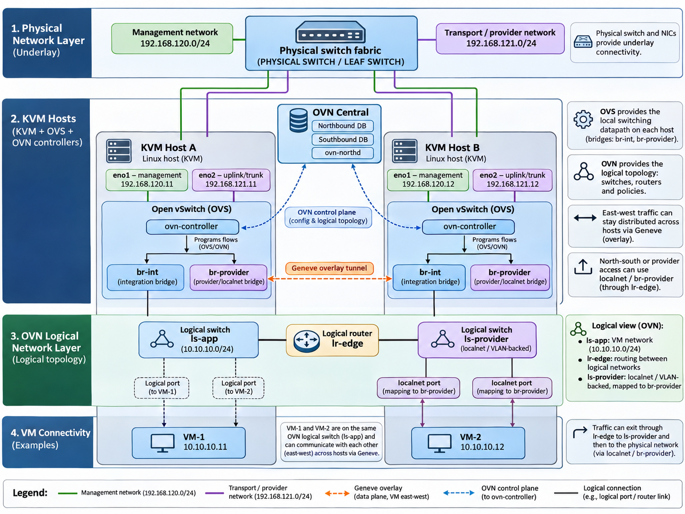

# 00 Before we begin

OVN is not a new hypervisor and not simply another Linux bridge. It is a **network control system** that tells Open vSwitch (OVS) on each KVM host how to implement logical switches, routers and policy. A VM still has a virtio NIC and a tap interface; OVN changes what the host does with its traffic. [1, 7, 8]

## Read this as a virtualization operator

| **Familiar idea**            | **OVN / OVS equivalent**                        |
|------------------------------|-------------------------------------------------|
| VM NIC / tap                 | The VM-facing interface on a KVM host           |
| Port group / virtual network | OVN logical switch (approximate analogy)        |
| Virtual NIC connection       | OVN logical switch port + OVS interface binding |
| Virtual switch dataplane     | Open vSwitch (usually br-int)                   |
| Distributed virtual router   | OVN logical router                              |
| Edge / uplink service node   | OVN gateway chassis + physical uplink           |

**The running example:** two hosts, kvm-a and kvm-b, run VMs in 10.10.10.0/24. Their transport IPs are 192.168.121.11 and 192.168.121.12. Later we add a second subnet and a physical network 198.51.100.0/24. These are example-only addresses; no OpenStack components are assumed.

## Physical-to-logical architecture

*Generic KVM + OVS + OVN*

Physical IPs are underlay addresses; OVN logical switches and VM IPs form the guest network. Diagram is conceptual, not a literal packet trace.
