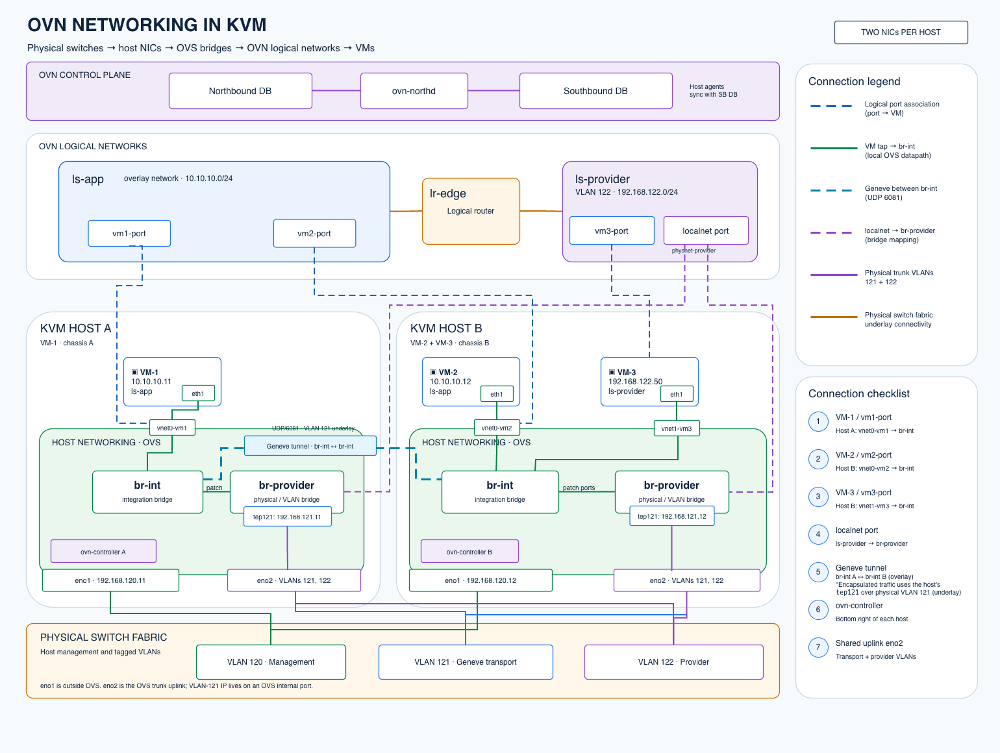
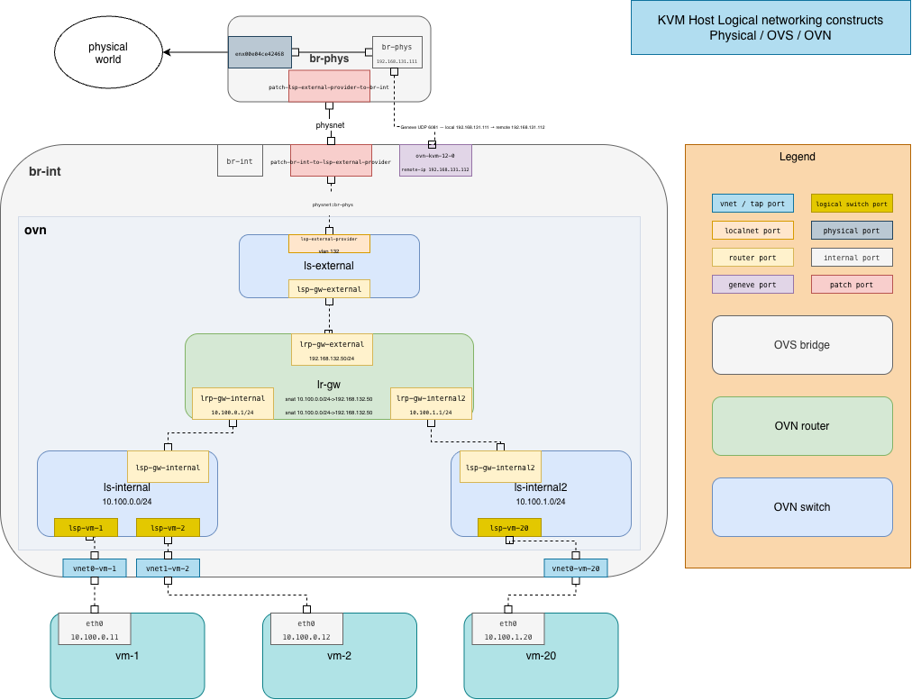

# Physical-to-logical architecture

*Generic KVM + OVS + OVN*

Physical IPs are underlay addresses; OVN logical switches and VM IPs form the guest network. Diagram is conceptual, not a literal packet trace.

