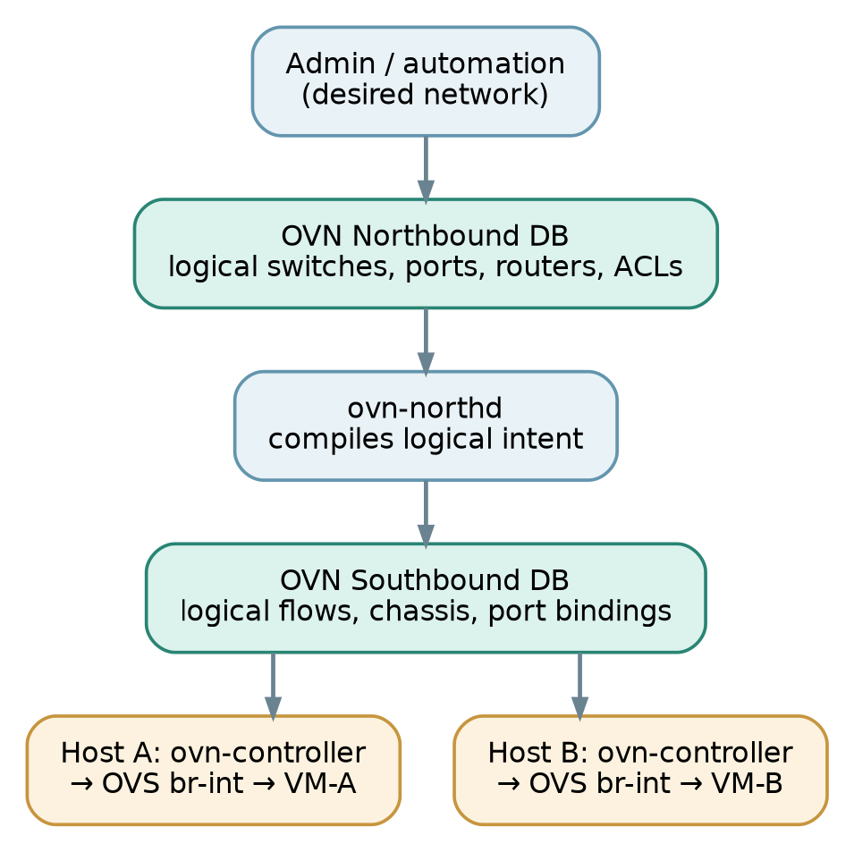

# 01 The three pictures to keep separate

Think of an OVN environment as three related diagrams, each answering a different question:

- **The logical topology:** Which VMs are connected to which switches and routers?
- **The physical topology:** Which KVM hosts, NICs, VLANs, leaf switches and IP routes carry the packets?
- **The control path:** Who translates desired logical topology into forwarding rules on each host?

Control information flows downward; packet forwarding happens locally on hosts.

A logical switch is **not** an OVS bridge with the same name. A logical router is **not** a Linux network namespace or a dedicated VM. OVN represents both as distributed logical datapaths, realized in OVS flows on the participating chassis. [1]

> **Mental Model:** The logical diagram tells you what connectivity should exist. The physical diagram tells you how packets reach the destination host. OVN’s control plane joins the two.
