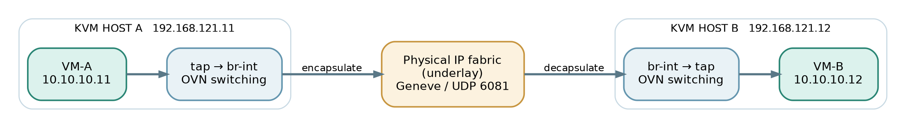

# 04 Switching between KVM hosts

Put VM-A (10.10.10.11) on kvm-a and VM-B (10.10.10.12) on kvm-b. Both join ls-app, so they behave as if plugged into one Layer-2 switch—even though they run on separate physical machines.

Overlay example: tenant Ethernet frames are carried across an ordinary IP underlay.

OVN learns that vm-b-port is bound to kvm-b. On kvm-a, OVS processes the logical switching pipeline, wraps the frame in **Geneve** and sends it to the other host’s transport IP. OVS on kvm-b removes the encapsulation and delivers the original frame to VM-B. [1, 5]

## What the physical fabric sees

The physical switches see traffic **between chassis IP addresses**, not the tenant IPs directly. They need IP reachability between 192.168.121.11 and 192.168.121.12, an appropriate MTU and permission for Geneve (normally UDP 6081). They do not need a separate VLAN for every logical network.

If both VMs happen to be on the same host, OVS can deliver the frame locally: no transport tunnel is needed for that hop. A VM migration changes the port binding; the logical address and network do not have to change.
