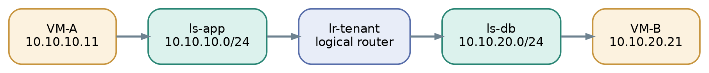

# 05 Routing without a router VM

Now add ls-db (10.10.20.0/24) and put VM-C (10.10.20.21) on it. Create one logical router, lr-tenant, with interfaces 10.10.10.1/24 and 10.10.20.1/24. VM-A uses 10.10.10.1 as its default gateway. [1, 2]

The logical view: routing exists, but there is no router appliance in the middle.

When VM-A sends to VM-C, local OVS can apply both the logical switch and router processing. If VM-C is remote, the resulting packet travels to its host. There is usually **no compulsory detour** through a central gateway to route between internal OVN logical switches.

The OVN router does ordinary L3 work: picks the next hop, decrements TTL and rewrites the Ethernet header. OVN distributes that behavior across the chassis where the relevant VMs run. [2]

> **Do Not Confuse:** Distributed router = routing logic available on participating hosts. Gateway chassis = a specific host chosen for external-network functions that cannot safely be fully distributed.
