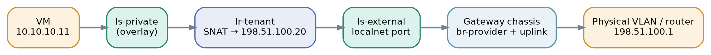

# 07 Gateways, SNAT and DNAT

A private logical network can reach external networks through a logical router connected to an external logical switch, whose localnet port reaches a real network. The router has a port on the external subnet; a default route points to the upstream physical router. [1, 3, 4]

North–south path. Shared SNAT state is handled on an active gateway chassis.

## Example: one public source address for many VMs

VM-A (10.10.10.11) sends to the Internet. OVN applies SNAT to use 198.51.100.20; upstream gateway 198.51.100.1 sends replies back. The external logical router port might use 198.51.100.10/24—and this is distinct from the SNAT address. Both addresses are examples.

**Shared, one-to-many SNAT** usually needs one active gateway chassis for the relevant gateway port: many connections share the same external identity and need consistent state and a single physical place to own the gateway MAC/IP. OVN redirects those packets to the selected chassis. [1]

**DNAT** maps an external address/port to an internal VM. A suitable one-to-one NAT mapping can be processed on the VM’s chassis in a distributed design, provided the external path and OVN configuration support it; do not assume all north–south traffic must traverse one gateway.

## Who does what?

- **Logical router port:** owns an external-side MAC and IP; is not a Linux IP on br-provider.
- **localnet port:** joins ls-external to a mapped physical bridge / VLAN.
- **Gateway chassis:** hosts the active physical-facing router functions for a distributed gateway port.
- **Physical router:** routes onward to WAN, core or other networks.
