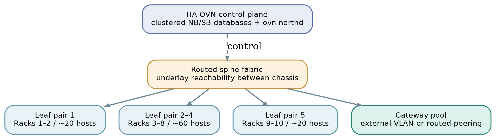

# 08 Availability and a 100-host design

OVN separates two availability questions: **Is the desired configuration still being distributed?** and **Can traffic still be forwarded when something fails?** Keep the answer to each explicit. [1, 3]

## Small cluster

In a two-host lab, the KVM hosts can also be eligible gateways, assuming both have access to the external VLAN. Configure more than one gateway chassis in priority order. OVN selects one active chassis for a distributed gateway port and can fail over on failure. Multiple logical routers can have different active gateways, spreading aggregate load.

## A larger example: 100 hosts / 10 racks

Illustrative leaf/spine layout: two racks per leaf pair and distinct gateway capacity.
- Use a **routed IP fabric** for chassis/tunnel endpoint reachability; logical tenant networks need not be stretched as VLANs.
- Run redundant **NB/SB database services and northd** on stable control nodes; place replicas across failure domains.
- Deploy a **gateway pool** with external L2 attachment or an explicitly designed routed handoff; size for throughput and failover capacity.
- Distribute different tenant routers across active gateways, but do not expect one shared-SNAT flow to be load-balanced across all gateways by default.
- If tenants use direct physical VLANs, plan VLAN reachability and bridge mappings on every chassis that must host those VMs.

Newer OVN dynamic-routing integrations can exchange routes with an external routing daemon such as FRR. That is an advanced alternative to a single shared L2 gateway segment—not a prerequisite for learning OVN. [9]
