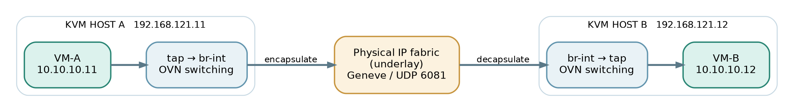

*A virtualization-first explanation*

# OVN Networking for KVM

**From a VM’s virtual NIC to the physical wire**

A concise, illustrated field guide for operators who know virtualization better than networking.

*One logical network · Two physical KVM hosts*

> **What this book does:** Builds the mental model first, then explains switching, routing, VLANs, tunnels, gateways and NAT through one running example.

Edition 1.1 · November 2026 · Generic KVM / libvirt / Open vSwitch / OVN

## Contents

- [00 Before we begin](00-before-we-begin.md)
- [Physical-to-logical architecture](00a-physical-to-logical-architecture.md)
- [01 The three pictures to keep separate](01-the-three-pictures-to-keep-separate.md)
- [02 The OVN components](02-the-ovn-components.md)
- [03 How a VM joins a logical switch](03-how-a-vm-joins-a-logical-switch.md)
- [04 Switching between KVM hosts](04-switching-between-kvm-hosts.md)
- [05 Routing without a router VM](05-routing-without-a-router-vm.md)
- [06 How physical VLANs connect](06-how-physical-vlans-connect.md)
- [07 Gateways, SNAT and DNAT](07-gateways-snat-and-dnat.md)
- [08 Availability and a 100-host design](08-availability-and-a-100-host-design.md)
- [09 What to check when traffic fails](09-what-to-check-when-traffic-fails.md)
- [10 Five rules to remember](10-five-rules-to-remember.md)
- [11 A compact lab recipe](11-a-compact-lab-recipe.md)
- [12 Glossary](12-glossary.md)
- [13 Sources and next steps](13-sources-and-next-steps.md)
